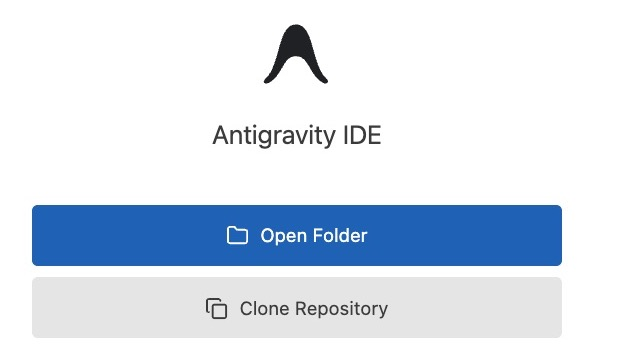
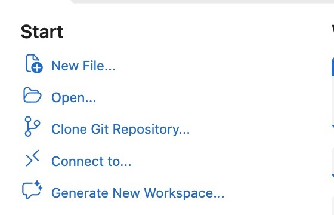

# kses-workshop

대한견주관절의학회 중개연구위원회 2026 실습 워크숍 실습 저장소입니다.
코딩 에이전트와 함께 R·Python으로 데이터를 분석하고, 그 결과로 원고를 작성합니다.

- 일시: 2026년 10월 24일 (토) 09:00–15:00
- 장소: 토즈모임센터 강남역토즈타워점

## 시작하기

Antigravity IDE(또는 Antigravity 확장을 사용하는 VS Code)를 열고, 아래 두 방법 중 하나로 실습 저장소를 받습니다. 터미널에서 Git 명령을 입력할 필요는 없습니다.

### Antigravity IDE

시작 화면의 **Clone Repository**를 클릭합니다.



### VS Code

빈 창의 Welcome 화면에서 **Clone Git Repository...**를 클릭합니다.



두 IDE 모두 저장소 주소를 묻는 입력창에 `https://github.com/qmakescl/kses-workshop.git`을 붙여넣습니다. 저장 위치로 `kses/` 폴더를 선택하면 그 안에 `kses-workshop/` 폴더가 만들어집니다. 복제가 끝나면 안내에 따라 **`kses-workshop` 폴더를 엽니다.**

복제한 `kses-workshop/` 폴더를 연 뒤 **Trust this folder**가 표시되면 이 저장소의 작성자를 확인하고 신뢰합니다. 이어서 IDE의 터미널을 열어 `kses-workshop/` 루트에서 `uv init --python 3.11`, `uv venv`를 차례로 실행합니다. Python 패키지는 이후 실습 단계에서 설치합니다.

개인 데이터를 가져온 분은 저장소 바깥의 `kses/private-data/`에 파일을 둡니다.

## 폴더 구조

```text
kses/
├─ kses-workshop/            ← 에이전트 작업 폴더 (이 저장소)
│   ├─ data/public/          ← 공개 실습 데이터 (anchor.csv)
│   ├─ data/mock/            ← 모의 데이터 (에이전트 생성)
│   ├─ docs/                 ← 프로파일, 코드북, 프롬프트 모음
│   ├─ R/                    ← R 스크립트
│   ├─ python/               ← Python 실습 스크립트
│   ├─ pyproject.toml        ← 실습 중 저장소 루트에 생성
│   ├─ .venv/                ← 실습 중 저장소 루트에 생성
│   ├─ output/               ← 표, 그림
│   └─ scripts/              ← 실습 중 사용할 보조 스크립트
└─ private-data/             ← 실제 개인 데이터 (저장소 바깥, 에이전트 비노출)
```

`AGENTS.md`는 초기 저장소에 포함하지 않고, 실습 과정에서 함께 작성합니다.

## 실습 논문과 공개 데이터

Hawa A, et al. [Is it enough to utilize a single anchor for repair of rotator cuff tears ≤ 3 * 3 cm²?](https://doi.org/10.1371/journal.pone.0320915) *PLoS One*. 2025;20(4):e0320915.

이 연구는 작은·중간 크기 회전근개 파열에서 단일 앵커와 다중 앵커 봉합 후 6개월 재파열률 및 임상 결과를 비교한 후향적 코호트 연구입니다. 논문 결과표는 성향점수 매칭 후 346명(각 군 173명)을 바탕으로 합니다. [원문](https://journals.plos.org/plosone/article?id=10.1371/journal.pone.0320915)과 [보충자료 S1 CSV](https://doi.org/10.1371/journal.pone.0320915.s001)를 먼저 확인하세요.

실습 CSV는 1,309행 중 ID만 있는 99행을 제외하면 1,210행이고, 양쪽 파열 직경 30 mm 이하 기준을 적용하면 1,021행입니다. 이 수치는 **실습 파일에서 계산한 단계별 행 수**입니다. 논문의 적격 1,210명·분석 가능 1,170명·매칭 후 346명과 같은 표본으로 단정하지 마세요. 자료 출처와 읽기 주의사항은 [data/public/README.md](data/public/README.md)에 정리했습니다.

## 개인 데이터 원칙

- 실제 환자 데이터는 **코딩 에이전트에게 보여주지 않습니다.**
- 에이전트는 공개 데이터와 모의 데이터로 스크립트를 만들고, 참가자가 그 스크립트를 개인 데이터에 직접 실행합니다.
- 개인 데이터는 이 저장소 바깥 `../private-data/`에 둡니다.

## 진행 순서

| 시간 | 내용 | 주요 파일 |
|---|---|---|
| 09:30 | 코드북 만들기 | `R/00_profile.R`, `docs/codebook_public.csv` |
| 10:05 | 제공 CSV 분석과 논문 비교 | `R/01_reproduce.R` |
| 10:30 | 회귀모형으로 재분석 | `R/02_model.R` |
| 11:00 | MNIST CNN | `python/mnist_cnn.py` |
| 11:25 | 로지스틱 회귀 vs 신경망 | `python/compare.py` |
| 13:00 | 글쓰기, Reporting Guideline | `docs/` |

각 단계의 프롬프트는 [docs/prompts.md](docs/prompts.md)에 있습니다.
